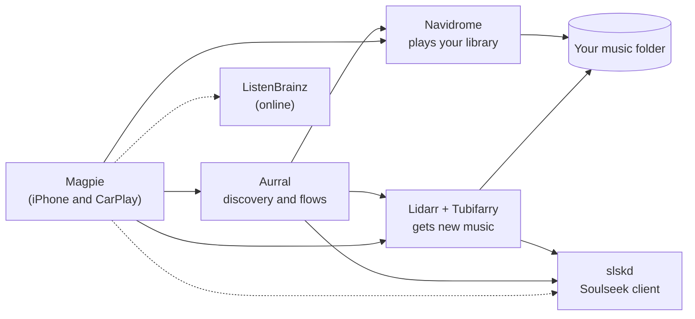

<h1 align="center">
  <picture>
    <source media="(prefers-color-scheme: dark)" srcset="docs/images/logo-dark.svg">
    
  </picture>
</h1>

<p align="center"><b>Your own music server, with the feel of a streaming service.</b></p>

Magpie is an iPhone and CarPlay app that tries to give you what a streaming app does (a Home screen that knows what
you like, fresh playlists every week, charts, search that finds any song, and a way to get the songs you don't have
yet) while every file stays on your own server. It plays your library from [Navidrome](https://www.navidrome.org),
finds new music through [Aurral](https://github.com/lklynet/aurral) and [ListenBrainz](https://listenbrainz.org), and
brings songs in with [Lidarr](https://lidarr.audio), [Tubifarry](https://github.com/TypNull/Tubifarry) and
[slskd](https://github.com/slskd/slskd).

Search for a song you don't have, tap **Try**, and a few minutes later it's playing. It lands in a separate *Finds*
folder, so you can **Keep** it or let it go, much like adding a song to a streaming library.

It is a personal project in early development: version 0.0.1, used day to day by its author against one home setup,
distributed only through TestFlight. It is not on the App Store. Expect rough edges.

<p align="center">
  
  
  
  
</p>
<p align="center"><sub>Screens rendered by the test suite from a made-up library, with generated covers. No real server or album art.</sub></p>

## The streaming experience, self-hosted

| What you'd expect from a streaming app | How Magpie does it |
|---|---|
| Playlists made for you, refreshed every week | Aurral's **flows**, plus ListenBrainz's weekly playlists |
| Charts, trending and "recommended for you" | Aurral's Discover: recommendations, trending by genre, editorial playlists and charts |
| Hear a song before you add it | 30-second previews, played through your Aurral server |
| Search that finds anything, not just what you own | Your library first, then a "Not in your library" band with a **Try** button |
| Add a song and it's just there | Lidarr fetches it (through Tubifarry and slskd), Navidrome picks it up, and Magpie tells you when it's ready |
| An artist page with their top songs | From Aurral, ListenBrainz or your library, with previews for the ones you don't have |
| Offline listening, in the car too | Downloads, a size-limited cache, and a full CarPlay app |

Every part beyond Navidrome is optional. Each feature works, is hidden, or explains why not, depending on which
services you connect. Navidrome alone is enough to use Magpie as a player.

## What it does

**Discovery, through Aurral**

Aurral is the heart of Magpie's discovery. It's a self-hosted discovery service that sits beside Lidarr and Navidrome
and keeps playlists up to date for each person on your server. Magpie turns it into a streaming-style Discover tab:
- **Recommended, Trending and editorial playlists**, with pictures and 30-second previews. All of it comes through
  your own Aurral server: the phone never contacts Deezer or Apple itself.
- **Flows**: playlists Aurral builds and keeps fresh on a schedule. Make your own from a mix you choose (discovery,
  your library, trending, a focus, new releases), with how many songs each update brings, years, tags and related
  artists. You can edit them, refresh them, or delete them.
- **Chart flows**: turn a chart's top 10, 20, 25, 50 or 100 songs into a playlist of your own that follows the chart.
- **Add** an editorial playlist as a flow, and say **Not for me** to a recommendation to teach Aurral your taste.
- New flows start fetching their songs by themselves. **Songs still coming** shows what Aurral is still fetching,
  with **Approve**, **Try another source** and **Search now** for your own songs, and **Search again** finds the ones
  that went missing.
- **Yours, or everyone's.** Each person signs in to Aurral as themselves, so Discover shows your own flows and
  playlists. With **Show everyone's flows and playlists** on, you see the rest of the household's too. They're matched
  to the person who made them, not by name, so two people's "Chill" stay apart (by Aurral's own record of each one's
  songs when two share a name). Another person's name is shown only when Aurral tells Magpie whose it is, which it does
  for Aurral admins.
- Discover is in the car too.

**Your library, through Navidrome**
- Browse playlists, artists, albums, songs and genres; search as you type; star favourites. Artists, Albums and
  Songs each have their own search field, and long lists have a header for each letter beside the A–Z bar.
- Playlists can show only yours or everyone's shared ones; under everyone's, each playlist says who made it.
- An artist's page shows their top songs (from Aurral, ListenBrainz or your library). With Lidarr connected, **In your
  library only, for artists in Lidarr** (Settings › Home & Library › Artist top songs, on by default) keeps an artist's
  top songs to the ones you already have when Lidarr looks after that artist; switch it off to see every top song,
  with 30-second previews for the ones you don't have. Artists Lidarr doesn't have always show every top song.
- A queue with shuffle and repeat, the lock screen and Control Centre, and synced lyrics when your server has them.
  Playback is gapless when the files carry gapless information.
- Download albums and playlists for offline listening, with a size-limited cache for what you stream.
- Several server addresses (home and away). Magpie uses the first that answers and switches when one stops
  responding.
- Three looks (Classic, Signature, Immersive), light and dark, and a Home screen and CarPlay layout you can rearrange.

**Getting new music: Try, Finds and Keep (Lidarr, optional)**
- Tap **Try** on a song or album you don't have (from search, an artist's page, a playlist or recommendations). Magpie
  works out which release holds it using MusicBrainz, then asks Lidarr to monitor and search for that release.
  Lidarr's own indexers and download clients do the downloading; Magpie never downloads music itself.
- With Tubifarry and slskd behind Lidarr, a Try usually takes a few minutes, with a live progress screen. Without
  Tubifarry, the button says **Ask for it**: the song shows up in Requests when Lidarr gets it.
- New artists go into a separate Finds folder. **Keep** moves a find into your main library and lets Lidarr upgrade it
  to lossless. **Not for me** deletes it again.
- After a Keep you can bring in more of the artist; if the find was a single, you choose to keep it or remove it once
  the album holding the song has arrived (only the single's files go, never the artist). Adding an artist always asks
  which of their albums, EPs and singles come.
- If the song is only on an album, Lidarr still downloads the whole album (Lidarr and its plugins only fetch whole
  releases). Magpie then removes the album's other songs from your Finds folder. A title track (a song named like its
  album) is fetched through its album first, because that is what searches for its name find.
- While a request is searching, it shows which release it is looking for. Stopping a request waits for a search still
  running in Lidarr to finish, cancels any download it started, and removes the album from your Finds folder if it
  arrived anyway. Nothing in your main library is deleted.
- **Safe by default.** Nothing is changed in Lidarr until you switch on **Allow Magpie to change Lidarr**. Every change
  goes through one write gate that only allows a short list of requests. It only touches artists and albums Magpie
  itself added or monitored, and logs each change on the phone before sending it. Your own artists, profiles and
  settings are left alone, with one opt-in exception below.
- **Change what's monitored (opt-in).** With **Let Magpie change what Lidarr monitors for my artists** switched on, an
  artist's menu lets you choose Albums, EPs and Singles. When fewer are monitored, Magpie asks whether to delete the
  songs that fall out or keep them (Keep is the default); kept songs can be removed later with **Clean up unmatched
  songs**, and **Put back how it was** restores the artist's previous profile. Favourites, songs in playlists and songs
  downloaded to the phone are never deleted, and every change is saved on the phone and checked against Lidarr before
  it is sent.

**Soulseek (slskd, optional)**
- Its own settings page. **Keep Soulseek connected** checks that slskd is connected, asks it to reconnect when it
  isn't, and lets you know if it still can't after about ten minutes.
- Removing an artist Magpie added also clears slskd's finished downloads of it (see the limits below).

**ListenBrainz (optional)**
- With a ListenBrainz token: your weekly playlists and recommendations. Plays are scrobbled through Navidrome; songs in
  Finds are never scrobbled.

**CarPlay**
- Home, Library, Finds and Search tabs, Now Playing with shuffle and repeat. It starts from the car even if the phone
  is locked, once the phone has been unlocked after a restart.
- Every list reaches its end, however small the car's screen: long lists open on letter groups or go on with "More…"
  pages, within the limits the car sets.

## Setting up your server

Magpie is only the app. The full experience needs these services running on your own server (a home server, a NAS or
a small Linux box; Docker is the usual way to run them). Start with Navidrome and add the rest as you want them.



| Service | What it does for Magpie | Needed for |
|---|---|---|
| [Navidrome](https://www.navidrome.org) 0.63.2 or newer | Your library: browsing, streaming, playlists, favourites, lyrics | Everything (required) |
| [Lidarr](https://lidarr.audio) 3.x | Monitors and downloads the songs and albums you Try | Try, Finds and Keep |
| [Tubifarry](https://github.com/TypNull/Tubifarry) (a Lidarr plugin) | Lets Lidarr search and download from Soulseek through slskd | Fast Try ("a few minutes") |
| [slskd](https://github.com/slskd/slskd) | The Soulseek client that Tubifarry (and Aurral) download through | Tubifarry; Keep Soulseek connected; clean-up |
| [Aurral](https://github.com/lklynet/aurral) 2.13 or newer | Recommendations, trending, charts, previews and flows | Discover |
| [ListenBrainz](https://listenbrainz.org) account | Weekly playlists, recommendations, scrobbling | Optional extras |

**1. Navidrome (required).** Point it at your music folder. Sign in to Magpie with an admin account if you can: a
normal account is fine for listening, but only an admin can ask Navidrome to scan, which Magpie does when new music
arrives.

**2. Lidarr.** Give Lidarr the **same music folder** as Navidrome as its root folder (Magpie checks that Navidrome
lists a song before calling it ready). Set a recycle bin (Settings › Media Management): **Not for me** deletes files,
and without one they're gone for good. For Finds, add a second root folder (for example `/music/finds`) that is not
inside your main one, and add the same folder to Navidrome as a library.

**3. slskd and Tubifarry.** Run slskd with your Soulseek account. Install Tubifarry in Lidarr, following Tubifarry's
own instructions, and connect it to slskd so Lidarr can search and download from Soulseek. Magpie notices Tubifarry
by itself. If you want Magpie to tidy slskd's downloads when it removes an artist, turn on slskd's remote file
management.

**4. Aurral.** Connect Aurral to your Lidarr and Navidrome and give it at least one download source (Soulseek through
slskd works well). Create an Aurral user for each person who will use Magpie: Magpie signs in to Aurral as that
person, so everyone gets their own flows.

**5. In Magpie.**
1. Sign in to Navidrome with its address, username and password.
2. Settings › Lidarr: enter Lidarr's address and API key (Lidarr › Settings › General). Magpie shows what it found and
   changes nothing yet. When you're ready, switch on **Allow Magpie to change Lidarr** and tap **Set up Magpie in
   Lidarr** (it adds its own profiles and tags, and edits nothing you have). Then choose your Finds folder.
3. Settings › Aurral: its address, and your Aurral username and password.
4. Optional: Settings › Soulseek (slskd) (slskd's address and API key) and Settings › ListenBrainz (your token).

Passwords and keys are kept in the iPhone's Keychain and never logged. Use HTTPS for any address that leaves your
home; [`docs/RUNBOOK.md`](docs/RUNBOOK.md) has the full checklist and what Magpie sends to Lidarr, exactly.

## What it doesn't do, and known limits

- **iOS 26 or newer, built with Xcode 27.1 or newer.** It is built for iPhone on iOS 26.0 and later, and its tests run
  on an iOS 27 simulator and an iOS 26.2 one. It installs on iPad, but the layout hasn't been designed for it.
- **AirPlay and Bluetooth go through the system.** Now Playing has the system's output picker ("Play on…"), and the
  lock screen, Control Centre, car and AirPlay receivers get the song and its controls. The simulator checks the picker,
  the audio session and the pause when an output goes away; real speakers, headphones and cars can only be tried on
  a phone.
- **Navidrome is required.** Magpie uses Navidrome's own API alongside the Subsonic one, so other Subsonic servers
  won't work. There's no Plex, Jellyfin or streaming-service support, and none is planned.
- **Getting music depends on your Lidarr setup.** Whether a Try succeeds depends on your indexers and download
  clients. It has been tested with Soulseek through Tubifarry. The song also needs to be in MusicBrainz and in Lidarr's
  metadata. A very new single sometimes isn't there yet; Magpie tries the song's other releases, and otherwise tells
  you it couldn't find it.
- **Finds don't expire on their own.** "Days left" is a reminder only. Keeping a find whose release was trimmed brings
  the whole release back in lossless.
- **Plain `http://` is allowed** so home servers work without certificates. Magpie asks before sending your password
  over plain http to a public address, but on an untrusted network your credentials can still be intercepted. Use
  HTTPS for anything that leaves your home network.
- **Background work is limited by iOS.** Requests are followed while the app runs and whenever iOS grants background
  time, so a download that finishes while the app is closed may only show up the next time you open it.
- **Not built yet:**
  - in CarPlay: Not for me;
  - Siri;
  - Live Activities.
- **Removing an artist Magpie added clears what it left behind** (Lidarr's blocklist entries for it, and, with the
  optional Soulseek (slskd) connection and its switch on, slskd's finished downloads of it). The slskd part needs
  slskd's remote file management turned on, and leaves alone any folder it can't tie to the artist for certain.
- **One developer, one test setup.** Most testing is automated against fakes. The full request path (search, grab,
  download, import, stop) is also tested against a real Lidarr in Docker, with a stand-in indexer and download client
  that serve generated audio. Real Soulseek and Aurral behaviour is only seen on the author's own server.

## Roadmap

There are no dates. These are the things most likely to come next, roughly in order:

1. Run CI on every pull request on GitHub (the workflows are in place; the hosted macOS runners need Xcode 27).
2. Try a whole artist, not just a song or an album.
3. Optional automatic expiry for finds you haven't kept.
4. iPad layouts.

Requests and ideas are welcome as issues. Larger changes start as a short plan
([how work is planned](docs/ways-of-working/process.md)).

## Building it yourself

You need a Mac with Xcode 27.1 and [XcodeGen](https://github.com/yonaskolb/XcodeGen) (`brew install xcodegen`).

```sh
git clone https://github.com/bleak-rooster/Magpie-Player.git
cd Magpie-Player
scripts/build.sh                       # generates Magpie.xcodeproj from project.yml and builds for the simulator
open Magpie.xcodeproj
```

To run it on your own iPhone, sign it with your own Apple developer team in Xcode. CarPlay needs Apple's CarPlay audio
entitlement on that team; without it, build the variant without CarPlay (`scripts/archive.sh --no-carplay`, or
`MAGPIE_CARPLAY=NO`). [`docs/TESTFLIGHT.md`](docs/TESTFLIGHT.md) walks through a TestFlight build.

## Development

```sh
cd Packages/MagpieKit && swift test     # package tests (macOS, about a minute)
scripts/test-app.sh                     # app and UI tests on a dedicated simulator (about 10 minutes)
scripts/check-writes.sh                 # checks every Lidarr write goes through the write gate
scripts/test-all.sh                     # everything a release needs
dev/bootstrap.sh                        # a local Navidrome and Lidarr in Docker, for integration tests
dev/fake-indexer/setup.sh               # gives that Lidarr a stand-in indexer and download client, so it downloads
```

Most of the logic lives in the Swift package `Packages/MagpieKit`: one module per service (`NavidromeKit`,
`LidarrKit`, `AurralKit`, `ListenBrainzKit`), plus `Requests` (Try and Finds), `Playback`, `Search`, `CarPlayUI` and
`DesignSystem`. The app target in `App/` is the SwiftUI layer. Tests never contact a real server.

Further reading:
- [`docs/decisions.md`](docs/decisions.md) — every product and engineering decision, numbered, with its reason.
- [`docs/FLOWS.md`](docs/FLOWS.md) — how each flow behaves.
- [`docs/RUNBOOK.md`](docs/RUNBOOK.md) — running and testing against your own servers.
- [`docs/ways-of-working/`](docs/ways-of-working/README.md) — the process, rules, templates and GitHub conventions.

## Contributing

Contributions are welcome. Please read [`CONTRIBUTING.md`](CONTRIBUTING.md) first. The short version:
- never commit a real server address, username or key;
- every Lidarr write goes through the write gate;
- write the failing test first.

If you use an AI coding assistant, point it at [`AGENTS.md`](AGENTS.md). Claude Code also picks up
[`CLAUDE.md`](CLAUDE.md) and the role definitions in [`.claude/agents/`](.claude/agents/).

Please report security or privacy problems privately, through GitHub's
[security advisories](https://github.com/bleak-rooster/Magpie-Player/security/advisories/new), not in a public issue.

## Licence

[MIT](LICENSE). You can use, change and redistribute Magpie, including in your own apps, as long as the copyright
notice stays with it.

Magpie is not affiliated with Navidrome, Lidarr, Tubifarry, slskd, Aurral, ListenBrainz or MusicBrainz. It relies on
their work, and on the people who keep MusicBrainz's data accurate.
