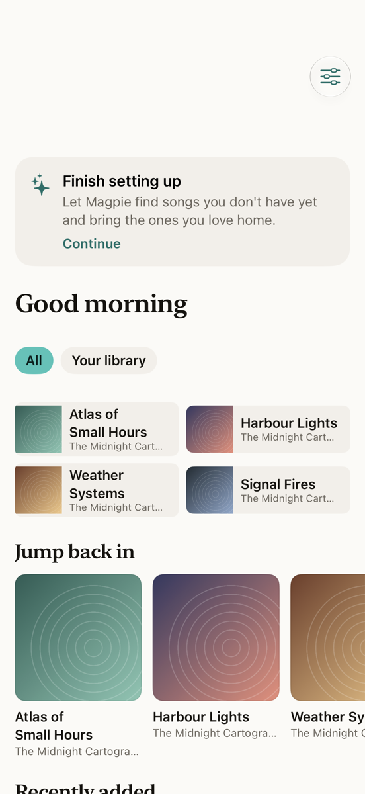
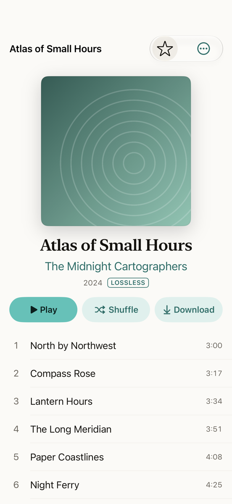
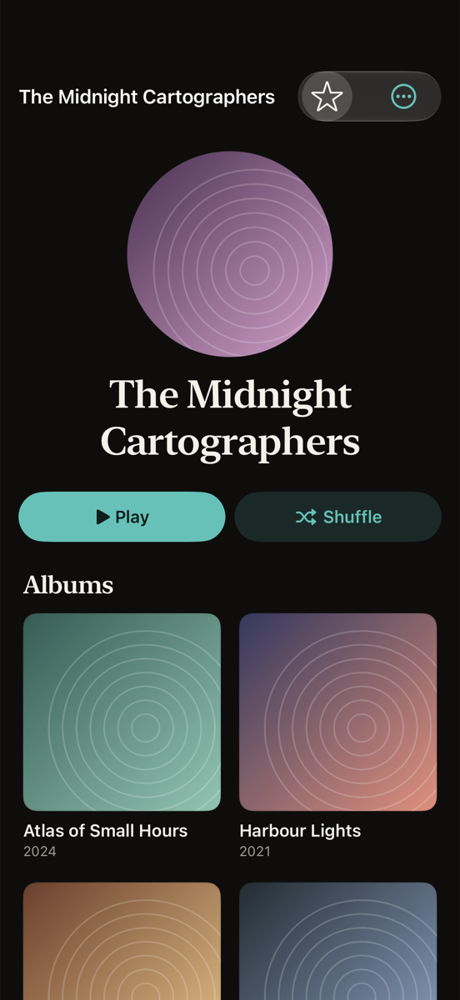
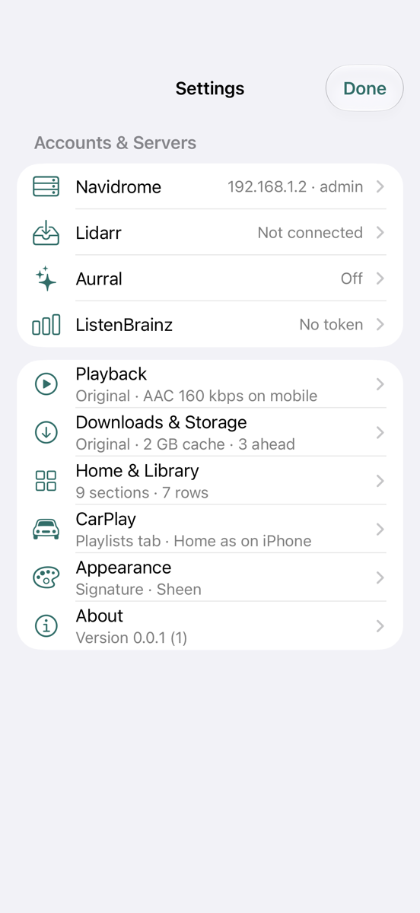

# Magpie

Magpie is an iPhone and CarPlay app for listening to your own music library on a [Navidrome](https://www.navidrome.org)
server. If you also run [Lidarr](https://lidarr.audio), it can ask Lidarr for songs and albums you don't have yet and
put them in a separate "Finds" folder, so you can try them before they join your library.

It is a personal project in early development: version 0.0.1, used day to day by its author against one home setup,
distributed only through TestFlight. It is not on the App Store. Expect rough edges.

<p align="center">
  
  
  
  
</p>
<p align="center"><sub>Screens rendered by the test suite from a made-up library, with generated covers. No real server or album art.</sub></p>

## What it does

**Your library, through Navidrome**
- Browse playlists, artists, albums, songs and genres; search as you type; star favourites. Artists, Albums and
  Songs each have their own search field, and long lists have a header for each letter beside the A–Z bar.
- Playlists can show only yours or everyone's shared ones; under everyone's, each playlist says who made it.
- An artist's page shows their top songs (from Aurral, ListenBrainz or your library). With Lidarr connected, **In your
  library only, for artists in Lidarr** (Settings › Home & Library › Artist top songs, on by default) keeps an artist's
  top songs to the ones you already have when Lidarr looks after that artist; switch it off to see every top song,
  with 30-second previews for the ones you don't have. Artists Lidarr doesn't have always show every top song.
- A queue with shuffle and repeat, the lock screen and Control Centre, and synced lyrics when your server has them.
  Playback is gapless when the files carry gapless information.
- Download albums and playlists for offline listening, with a size-limited cache for what you stream.
- Several server addresses (home and away). Magpie uses the first that answers and switches when one stops
  responding.
- Three looks (Classic, Signature, Immersive), light and dark, and a Home screen and CarPlay layout you can rearrange.

**CarPlay**
- Home, Library, Finds and Search tabs, Now Playing with shuffle and repeat. It starts from the car even if the phone
  is locked, once the phone has been unlocked after a restart.
- Every list reaches its end, however small the car's screen: long lists open on letter groups or go on with "More…"
  pages, within the limits the car sets.

**Finds, through Lidarr (optional)**
- Tap **Try** on a song or album you don't have (from search, an artist's page, a playlist or recommendations). Magpie
  works out which release holds it using MusicBrainz, then asks Lidarr to monitor and search for that release.
  Lidarr's own indexers and download clients do the downloading; Magpie never downloads music itself.
- New artists go into a separate Finds folder. **Keep** moves a find into your main library and lets Lidarr upgrade it
  to lossless. **Not for me** deletes it again.
- After a Keep you can bring in more of the artist; if the find was a single, you choose to keep it or remove it once
  the album holding the song has arrived (only the single's files go, never the artist). Adding an artist always asks
  which of their albums, EPs and singles come.
- If the song is only on an album, Lidarr still downloads the whole album (Lidarr and its plugins only fetch whole
  releases). Magpie then removes the album's other songs from your Finds folder. A title track (a song named like its
  album) is fetched through its album first, because that is what searches for its name find.
- While a request is searching, it shows which release it is looking for. Stopping a request waits for a search still
  running in Lidarr to finish, cancels any download it started, and removes the album from your Finds folder if it
  arrived anyway. Nothing in your main library is deleted.
- Nothing is changed in Lidarr until you switch on **Allow Magpie to change Lidarr**. Every change goes through one
  write gate that only allows a short list of requests. It only touches artists and albums Magpie itself added or
  monitored, and logs each change on the phone before sending it. Your own artists, profiles and settings are left
  alone, with one opt-in exception below.
- **Change what's monitored (opt-in).** With **Let Magpie change what Lidarr monitors for my artists** switched on, an
  artist's menu lets you choose Albums, EPs and Singles. When fewer are monitored, Magpie asks whether to delete the
  songs that fall out or keep them (Keep is the default); kept songs can be removed later with **Clean up unmatched
  songs**, and **Put back how it was** restores the artist's previous profile. Favourites, songs in playlists and songs
  downloaded to the phone are never deleted, and every change is saved on the phone and checked against Lidarr before
  it is sent.
- **Soulseek (slskd), optional.** Its own settings page. **Keep Soulseek connected** checks that slskd is connected,
  asks it to reconnect when it isn't, and lets you know if it still can't after about ten minutes.

**Discovery (optional)**
- With [Aurral](https://github.com/lklynet/aurral): charts, recommendations, previews and Aurral's "flows" (playlists
  it builds and keeps up to date). Flows and playlists are matched to the person who made them, not by name (by
  Aurral's own record of each one's songs when two share a name), so two people's "Chill" stay apart. Another
  person's name is shown only when Aurral tells Magpie whose it is, which it does for Aurral admins. You can delete your own flows and playlists, and **Songs still coming** shows what
  Aurral is still fetching, with Approve, Try another source and Search now for your own songs.
- With a [ListenBrainz](https://listenbrainz.org) token: your weekly playlists and recommendations. Plays are
  scrobbled through Navidrome; songs in Finds are never scrobbled.

Every feature works, is hidden, or explains why not, depending on which of these you connect. Navidrome alone is
enough to use Magpie as a player.

## What it doesn't do, and known limits

- **iOS 26 or newer, built with Xcode 27.1 or newer.** It is built for iPhone on iOS 26.0 and later, and its tests run
  on an iOS 27 simulator and an iOS 26.2 one. It installs on iPad, but the layout hasn't been designed for it.
- **AirPlay and Bluetooth go through the system.** Now Playing has the system's output picker ("Play on…"), and the
  lock screen, Control Centre, car and AirPlay receivers get the song and its controls. The simulator checks the picker,
  the audio session and the pause when an output goes away; real speakers, headphones and cars can only be tried on
  a phone.
- **Navidrome is required.** Magpie uses Navidrome's own API alongside the Subsonic one, so other Subsonic servers
  won't work. There's no Plex, Jellyfin or streaming-service support, and none is planned.
- **Getting music depends on your Lidarr setup.** Whether a Try succeeds depends on your indexers and download
  clients. It has been tested with Soulseek through [Tubifarry](https://github.com/TypNull/Tubifarry). The song also
  needs to be in MusicBrainz and in Lidarr's metadata. A very new single sometimes isn't there yet; Magpie tries the
  song's other releases, and otherwise tells you it couldn't find it.
- **Finds don't expire on their own.** "Days left" is a reminder only. Keeping a find whose release was trimmed brings
  the whole release back in lossless.
- **Plain `http://` is allowed** so home servers work without certificates. Magpie asks before sending your password
  over plain http to a public address, but on an untrusted network your credentials can still be intercepted. Use
  HTTPS for anything that leaves your home network.
- **Background work is limited by iOS.** Requests are followed while the app runs and whenever iOS grants background
  time, so a download that finishes while the app is closed may only show up the next time you open it.
- **Not built yet:**
  - in CarPlay: Not for me;
  - Siri;
  - Live Activities.
- **Removing an artist Magpie added clears what it left behind** (Lidarr's blocklist entries for it, and, with the
  optional Soulseek (slskd) connection and its switch on, slskd's finished downloads of it). The slskd part needs
  slskd's remote file management turned on, and leaves alone any folder it can't tie to the artist for certain.
- **One developer, one test setup.** Most testing is automated against fakes. The full request path (search, grab,
  download, import, stop) is also tested against a real Lidarr in Docker, with a stand-in indexer and download client
  that serve generated audio. Real Soulseek behaviour is only seen on the author's own server.

## Roadmap

There are no dates. These are the things most likely to come next, roughly in order:

1. Run CI on every pull request on GitHub (the workflows are in place; the hosted macOS runners need Xcode 27).
2. Try a whole artist, not just a song or an album.
3. Optional automatic expiry for finds you haven't kept.
4. iPad layouts.

Requests and ideas are welcome as issues. Larger changes start as a short plan
([how work is planned](docs/ways-of-working/process.md)).

## Building it yourself

You need a Mac with Xcode 27.1 and [XcodeGen](https://github.com/yonaskolb/XcodeGen) (`brew install xcodegen`).

```sh
git clone https://github.com/bleak-rooster/Magpie-Player.git
cd Magpie-Player
scripts/build.sh                       # generates Magpie.xcodeproj from project.yml and builds for the simulator
open Magpie.xcodeproj
```

To run it on your own iPhone, sign it with your own Apple developer team in Xcode. CarPlay needs Apple's CarPlay audio
entitlement on that team; without it, build the variant without CarPlay (`scripts/archive.sh --no-carplay`, or
`MAGPIE_CARPLAY=NO`). [`docs/TESTFLIGHT.md`](docs/TESTFLIGHT.md) walks through a TestFlight build.

## Development

```sh
cd Packages/MagpieKit && swift test     # package tests (macOS, about a minute)
scripts/test-app.sh                     # app and UI tests on a dedicated simulator (about 10 minutes)
scripts/check-writes.sh                 # checks every Lidarr write goes through the write gate
scripts/test-all.sh                     # everything a release needs
dev/bootstrap.sh                        # a local Navidrome and Lidarr in Docker, for integration tests
dev/fake-indexer/setup.sh               # gives that Lidarr a stand-in indexer and download client, so it downloads
```

Most of the logic lives in the Swift package `Packages/MagpieKit`: one module per service (`NavidromeKit`,
`LidarrKit`, `AurralKit`, `ListenBrainzKit`), plus `Requests` (Try and Finds), `Playback`, `Search`, `CarPlayUI` and
`DesignSystem`. The app target in `App/` is the SwiftUI layer. Tests never contact a real server.

Further reading:
- [`docs/decisions.md`](docs/decisions.md) — every product and engineering decision, numbered, with its reason.
- [`docs/FLOWS.md`](docs/FLOWS.md) — how each flow behaves.
- [`docs/RUNBOOK.md`](docs/RUNBOOK.md) — running and testing against your own servers.
- [`docs/ways-of-working/`](docs/ways-of-working/README.md) — the process, rules, templates and GitHub conventions.

## Contributing

Contributions are welcome. Please read [`CONTRIBUTING.md`](CONTRIBUTING.md) first. The short version:
- never commit a real server address, username or key;
- every Lidarr write goes through the write gate;
- write the failing test first.

If you use an AI coding assistant, point it at [`AGENTS.md`](AGENTS.md). Claude Code also picks up
[`CLAUDE.md`](CLAUDE.md) and the role definitions in [`.claude/agents/`](.claude/agents/).

Please report security or privacy problems privately, through GitHub's
[security advisories](https://github.com/bleak-rooster/Magpie-Player/security/advisories/new), not in a public issue.

## Licence

[MIT](LICENSE). You can use, change and redistribute Magpie, including in your own apps, as long as the copyright
notice stays with it.

Magpie is not affiliated with Navidrome, Lidarr, Tubifarry, Aurral, ListenBrainz or MusicBrainz. It relies on their
work, and on the people who keep MusicBrainz's data accurate.
