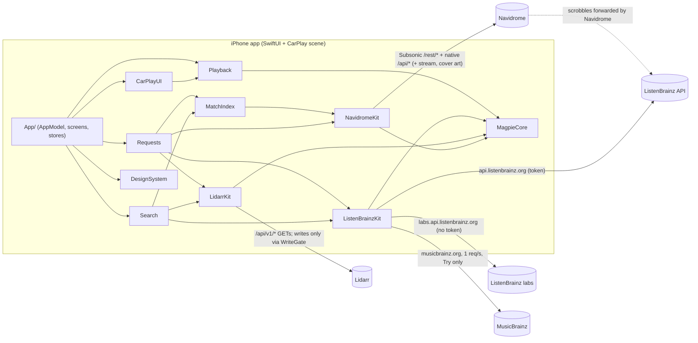

# Magpie: what it does and how

A short technical summary for the owner, written from the code on branch `v1-finds`. Service names are used freely here. In the app itself the words follow the design language (§5): "Not in your library yet", "Finds", "Keep", "Count plays".

## 1. What Magpie is

Magpie is an iPhone and CarPlay player for **your own Navidrome**. It can optionally ask **your Lidarr** to fetch a song you don't have ("Try"), and read **ListenBrainz** for search and "Made for you" playlists. There is no Magpie backend: the phone talks straight to your servers and to a few public metadata services.

| In v1 | Not in v1 |
|---|---|
| Sign-in with several addresses and automatic failover | Offline downloads, or any on-device copy of audio |
| Browse, search, play (AVQueuePlayer), queue, shuffle and repeat, lock screen and CarPlay Now Playing, lyrics (if the server has them), stars | App-side transcoding, or a quality/bitrate setting (the app never asks Navidrome for one) |
| Scrobbling through Navidrome ("Count plays"); finds are never scrobbled | Quick fetch (slskd/Soulseek). The `quickFetch` tier exists in the code but nothing ever selects it |
| Merged search: library, then ListenBrainz labs and Lidarr | Push notifications, Live Activity. The "ready" notice is a local notification, posted only while the app runs |
| Try: Lidarr adds or monitors one release and searches; the song is Ready once Navidrome lists it | Automatic expiry of finds ("days left" is display only) |
| Finds mode: a separate Finds folder, Keep (move into the library), Not for me (delete), Bring in more, Follow | Up Next and Downloaded in CarPlay; Not for me or Bring in more from the car |
| Made for you (ListenBrainz created-for playlists), "Not in your library" albums on the Artist page | Background fetch. Requests are only polled while the app process runs |

## 2. Architecture

MagpieCore holds the models, the HTTP transport (ephemeral, no URL cache, same-origin redirects only), the Keychain wrapper, atomic file writes and log redaction.

## 3. Flows

### a. Sign-in and session
- **Address parsing.** Text without a scheme becomes `http://` for loopback, private or home-network hosts (10/8, 172.16/12, 192.168/16, 169.254/16, 100.64/10, `.local`, single-word names, IPv6 ULA and link-local) and `https://` otherwise. An address with `user:pass@` is refused.
- **Plain-http consent.** Before any password or API key goes over `http://` to a public host, the owner must agree. Consent is remembered per origin in UserDefaults (`magpie.plainHTTPConsent`).
- **Probe.** Each address is tried in order with `GET /rest/ping?v=1.16.1&c=Magpie&f=json` (no credentials, 6 s timeout). It counts only if the answer is 2xx and a real `subsonic-response`: `ok`, or `failed` with a version and an auth error code (10, 40–44). A router page or captive portal gets no password.
- **Login.** `POST /auth/login {username, password}` returns a JWT plus a server-issued Subsonic token and salt. Subsonic calls send `u, t, s, v=1.16.1, c=Magpie, f=json`. If the server gave no token/salt, the app uses `md5(password+salt)` with a random salt. The password itself is never put in a URL. Native `/api/*` calls send the JWT in `X-ND-Authorization` and adopt a refreshed one when the server sends it.
- **Re-login.** A 401, or Subsonic error 40/44, triggers one shared re-login and one retry.
- **Failover.** On a connection error (timeout, host not found, connection lost…), the app re-probes the addresses in order, switches to the first one that answers, rebuilds the client and retries once. A playback error triggers the same check. If the address changed, the player rebuilds every stream URL and seeks back to where it was.
- **Stored.** Addresses and credentials are kept in the Keychain (service `com.bleak-rooster.magpie.session`, `AfterFirstUnlockThisDeviceOnly`). A launch before first unlock waits for unlock and does not sign out.
- **Sign-out** stops playback and clears:
  - the Keychain session and the Lidarr connection;
  - the Lidarr write switch, setup and Finds setup;
  - the account's Finds keys, the match-index snapshot and the requests file;
  - the in-memory artwork cache.

  It keeps the Lidarr change log, the ledger and the ListenBrainz token.

Code: `App/ServerAddress.swift`, `App/AppModel.swift`, `App/SessionStore.swift`, `Packages/MagpieKit/Sources/NavidromeKit/{NavidromeClient,SubsonicAuth,SubsonicPing}.swift`, `MagpieCore/{Keychain,HTTPTransport,RedirectPolicy}.swift`

### b. Browsing and the match index
- **Browsing** uses Subsonic calls: `getAlbumList2` (Home: recent, newest and frequent, 12 each; Library: alphabetical, pages of 60), `getAlbum`, `getArtists`, `getArtist`, `getPlaylists`/`getPlaylist`, `getTopSongs` (the Artist "Popular" list, only if the server has Last.fm), and `getCoverArt` at 120/300/600/1000 px.
- **Cover art** is cached **in memory only** (NSCache, 400 items, keyed by server, account, id and size) and cleared on sign-in and sign-out. Nothing about cover art is written to disk.
- **Match index.** After sign-in the app loads the last snapshot, then rebuilds the index in the background from `GET /api/song?_start&_end&_sort=id&_order=ASC`. It reads pages of 1,000, skips songs marked `missing`, and stops at 2,000 pages or when a server ignores paging. The index keeps only what the match ladder needs:
  1. MBID
  2. ISRC
  3. artist MBID + title + duration ±3 s
  4. artist name + title + duration ±3 s
  5. artist name + title, a duration unknown

  A match must score at least 0.8. A name-only match counts in search only when it is unambiguous.
- **Stored.** The snapshot is saved to `Application Support/Magpie/MatchIndex/<sha256(server|user)>.json` with an atomic write (`completeFileProtectionUntilFirstUserAuthentication`) and is excluded from backup. A failed refresh keeps the previous index.

Code: `MatchIndex/{MatchIndexStore,MatchIndex,Normalize}.swift`, `App/Screens/Shared/Artwork.swift`, `App/Screens/Home/HomeView.swift`, `App/Screens/Library/*`

### c. Playback and streaming
- **Stream URL.** `GET /rest/stream?id=<song>&estimateContentLength=true` plus the Subsonic auth parameters. The app sends **no `format` and no `maxBitRate`**: the stream-URL builder supports them, but they are always nil. **Magpie never transcodes.** Whatever transcoding happens is Navidrome's own server-side choice. With no format requested, Navidrome normally sends the original file.
- **What gets stored on the server** is decided by the Magpie quality profiles in Lidarr:
  - *Fast Start* (MP3-320 / MP3 V0, no upgrade) for Try;
  - *Lossless* (FLAC, upgrades allowed) after Keep.
- **Engine.** One `Player` owns the queue and drives an `AVQueuePlayer`. It holds at most 3 items and appends the next one when 20 s or less are left, or straight away when the length is unknown. That makes playback gapless when the files carry gapless info.
- **Audio session.** `.playback` / `.longFormAudio`, activated on the first play (so CarPlay doesn't cut the car's radio early).
- **Pauses and recovery.** Playback pauses when headphones or the car disconnect. It resumes after an interruption when the system recommends it, and the player is rebuilt if media services reset.
- **Failures.** A failed current song stops playback rather than skipping through the queue. Repeat (off/all/one) and shuffle are kept in memory only.
- **Background audio** works through `UIBackgroundModes: audio`.
- **Now Playing** (lock screen, Control Center, CarPlay) gets the title, artist, album, times, queue index and artwork. The artwork is a 600 px cover fetched with an ephemeral session that has no cache.
- **Remote commands:** play, pause, toggle, next, previous, seek, shuffle, repeat and like (which stars the song).
- **Lyrics** use `getLyricsBySongId`. The button shows only when `getOpenSubsonicExtensions` lists `songLyrics`.
- **No audio is ever cached or stored on the device.** Streams use AVPlayer's normal network loading, and the app has no download code.

Code: `Playback/{Player,AVQueueEngine,PlaybackEngine,Queue,NowPlayingBridge}.swift`, `App/Playback/NavidromeAdapters.swift`, `NavidromeClient.streamURL`, `LidarrKit/Provisioner.swift` (profiles), `project.yml` (background mode)

### d. Scrobbling ("Count plays")
- **When.** When a song starts, the app sends `scrobble?submission=false` ("now playing"). At 50 % of the song or 240 s, whichever comes first, it sends `submission=true` with the start time.
- **Who forwards it.** Navidrome passes the play on to ListenBrainz or Last.fm if *you* have linked them in Navidrome. The app itself never posts listens to ListenBrainz.
- **The switch.** Count plays is on by default and stored in UserDefaults (`magpie.countPlays`). It is read on every scrobble.
- **D29: finds are never scrobbled.** Neither "now playing" nor the submission is sent for a find. A song counts as a find when any of these is true:
  - its library id is the Finds library;
  - it is among the Finds library's songs as last read (saved in UserDefaults);
  - it belongs to a ready Finds-mode request.
- **Fail-closed.** While a Finds library is set but its songs aren't known yet, every song without a library id counts as a find. A song confirmed in the main library after Keep stops being a find.

Code: `Playback/Player.swift` (`scrobble`, `maybeSubmitScrobble`), `App/Playback/NavidromeAdapters.swift` (`FindsIdentity`, `NavidromeScrobbler`), `App/AppModel+Finds.swift`

### e. Search
- **Sources run in parallel.** Library `search3` has a 3 s deadline on the phone. ListenBrainz labs `recording-search` (songs only, no token) and, when Lidarr is connected, Lidarr `GET /search` (artists and albums only) each have 5 s. In the car the outside sources get 1.5 s.
- **Library rows come first** and show as soon as the library answers.
- **The "Not in your library" band** shows outside songs, albums and artists. An outside hit is dropped when the match index, or the library rows on screen, already have it. It is limited to 10 songs, 8 albums and 5 artists, with one row per artist and title.
- **Failures.** A source that fails or runs out of time adds nothing. A search fails only when the library fails *and* nothing came from outside.
- **What can be tried.** Only songs have Try. Album and artist rows are information only.

Code: `Search/{MergedSearch,SearchSections}.swift`, `ListenBrainzKit/ListenBrainzClient.swift`, `App/AppModel.swift` (`mergedSearch`), `App/Screens/Search/*`

### f. Requesting a song ("Try")
"Quick" here means Lidarr's normal search-and-download pipeline. **Quick fetch via slskd is not built in v1.**

- **Preconditions** (`tryAvailability`): Lidarr connected, "Allow Magpie to change Lidarr" on, "Set up Magpie in Lidarr" done, and a main root folder chosen.
- **Speed tier.** Standard ("usually a few minutes", live wait screen) when Lidarr's `/system/plugins` mentions Tubifarry. Otherwise Patient ("can take a few hours", "Ask for it", no wait screen). These are estimates shown to you, not guarantees.
- **Limits.** At most 5 places are in use at once: requests plus releases from Bring in more. A second Try of the same song returns the existing request.
- **Resolve.**
  - `GET musicbrainz.org/ws/2/recording/<mbid>?inc=releases+release-groups+isrcs+artist-credits`, at most 1 request per second, Try only. A song with no recording MBID fails ("no release").
  - Release choice: the smallest release group containing the song. Groups with no secondary type come first, then Official, then Single < EP < Album, then the earliest date.
  - For a **new artist**, only Official Album/EP/Single studio releases qualify. For an **artist already in Lidarr**, only the release groups Lidarr already lists qualify, and the artist's profiles are never changed.
- **Lidarr writes** (all through the WriteGate):
  - *Artist already in Lidarr:* `PUT /album/monitor {albumIds:[id], monitored:true}` (only if it isn't monitored yet), then `POST /command {name:"AlbumSearch", albumIds:[id]}`. Nothing about the artist is changed.
  - *New artist:* one `POST /artist` built from `artist/lookup?term=lidarr:<mbid>`. It sets the root folder, the *Fast Start* quality profile, the *Magpie Finds* metadata profile, `monitored:true`, `monitorNewItems:"none"`, tags, `addOptions {albumsToMonitor:[rg], searchForMissingAlbums:true}`. `addOptions.monitor` is deliberately left out.
  - *Fallback mode* (Finds off or not complete): main root, tag `magpie`.
  - *Finds mode:* the Finds root with tags `magpie` + `magpie-find`, but only if the Finds root still checks out against freshly read root folders. Otherwise the song goes into the main root and the sheet says so.
- **Persist before write.** The request list (`addSent`, ids) is saved before every write. The ledger entry is saved as "unclear" before a monitor PUT and updated after it. If the save fails, nothing is sent.
- **Progress.** The runner polls every 5 s in the foreground and every 30 s otherwise, while the process runs. It reads:
  - `queue/details` for progress and stuck imports;
  - `history/since` for grabbed, imported and failed events;
  - `command/<id>` to tell whether the search has finished.

  Ten minutes with nothing grabbed after the search finished means "still looking". Retries resend `AlbumSearch` after 1, 5 and 15 min, then hourly, and the request gives up after 24 h.
- **Ready** means *Navidrome lists the song*, not that Lidarr imported it:
  - After an import, the app starts a quick scan of the whole library (`startScan?fullScan=false`, no target). Scans repeat every 2–10 min.
  - The match index is refreshed every 30 s–5 min, at least 2 min apart while a scan runs.
  - Whenever the index matches the recording, the request becomes Ready.
  - Still not listed 20 min after the import: "Not showing up in your library yet" with **Check again**.

  Targeted scans are used only by Keep.
- **Landing (D6).** If you are still on the song's wait screen with the app in the foreground and nothing is playing, it plays. Otherwise it goes next in the queue (never cutting in) and a **Play now** banner appears. Patient requests don't land: they just appear in the library or Finds. A local "is ready" notification is posted if allowed.
- **Cancel** never deletes. It unmonitors the album only if the ledger says Magpie monitored it, it isn't kept, no other live request needs it, and a fresh GET shows it is still monitored. For a newly added artist it keeps checking for 10 min. An artist Magpie added stays in Lidarr.

Code: `Requests/{RequestRunner,RequestMachine,ReleasePicker,RequestStore}.swift`, `ListenBrainzKit/MusicBrainzClient.swift`, `App/AppModel+Requests.swift`, `App/AppModel+Landing.swift`, `Playback/LandingRule.swift`, `App/ReadyNotifier.swift`, `App/Screens/Try/TrySheet.swift`

### g. Finds
- **Setup** writes nothing to Lidarr. You pick a Finds root from Lidarr's root folders and confirm it ("Use … for Finds?"). It is refused if it equals, holds or sits inside another root or the main root. You then pick the Navidrome library that is the same folder (`/api/library`, which needs an admin login on some versions) and, if Lidarr and Navidrome see different mount paths, a Lidarr→Navidrome path mapping. Last, you turn on "Use a Finds folder". The setup is stored in UserDefaults per Lidarr instance and Navidrome account (`magpie.finds.<lidarr>.<navidrome>`).
- **Shelf.** The Finds library's songs come from `/api/song?library_id=` (pages of 500, at most 200 pages, and it says when the read is partial). New finds are finds not played yet. "Days left" is 7 minus whole days since the song was added. Nothing leaves on its own.
- **Keep** is only for an artist the ledger says Magpie created, tagged `magpie-find`, strictly inside the Finds root (fresh reads), with no move or other command queued in Lidarr.
  - **Normal case:** one `PUT /artist/editor {artistIds:[id], rootFolderPath:<main root>, moveFiles:true, qualityProfileId:<Magpie Lossless>, tags:[magpie-find], applyTags:"remove"}`.
  - **Proving the move:** Magpie then waits for Lidarr's `BulkMoveArtist`. It confirms every track file is on disk in the new folder using Lidarr's **filesystem listing** (`GET /filesystem`), because Lidarr 3.2 leaves `trackfile` paths stale after a move. It also checks the old folder is gone.
  - **After the move:** a *targeted* scan of the Finds library and the artist's new folder (`startScan` with `target=<libraryId>:<path>`, through the mapping), and the song is looked up again by recording MBID in its new folder. It shows "Lossless soon" until the FLAC arrives.
  - **Name clash:** if the main root already has a folder of that name, or Lidarr's folder name differs at all from the current one, only the tag comes off ("stays in your Finds folder").
  - **Failed move:** a failure is put back. Anything it can't settle within 30 min or 5 restore writes ends in **Needs attention**, and nothing more is written.
- **Not for me** deletes the whole release, and only for a ready Finds-mode find of an artist Magpie added.
  - **Checks first:** a confirm sheet reads Lidarr's recycle bin and says "deletes permanently" if none is set. Each step re-proves the preconditions on fresh reads: ledger, nothing of the artist kept, Finds root valid, `magpie-find`, every file strictly inside the Finds root and the artist folder, and every file on disk where Lidarr records it.
  - **Writes:**
    - `DELETE /trackfile/bulk {trackFileIds}` (or one `DELETE /trackfile/{id}` at a time if the bulk route is missing);
    - `PUT /album/monitor {monitored:false}`;
    - `DELETE /artist/{id}?deleteFiles=false&addImportListExclusion=false`, only when the artist's folder holds no file at all on disk.

    Each step is bounded (30 min), and failures end in Needs attention.
- **Bring in more** (only after a Keep that moved the find): `PUT /album/monitor {monitored:true}` for the releases you pick (newest first, at most 20, and within the room left in the limit of 5), then one `AlbumSearch`.
- **Follow new releases:** `PUT /artist/editor {artistIds:[id], monitorNewItems:"new"}`, skipped if the artist already follows.

Code: `App/{FindsSetupStore,AppModel+Finds,AppModel+Keep,AppModel+NotForMe,AppModel+BringInMore}.swift`, `Requests/RequestRunner+{Keep,NotForMe,BringInMore}.swift`, `LidarrKit/{PathGuard,LidarrClient}.swift`, `App/Screens/Finds/FindsShelf.swift`

### h. Made for you and "Not in your library"
- **Made for you** appears only with a ListenBrainz token. The token is checked with `GET api.listenbrainz.org/1/validate-token` before it is saved to the Keychain.
- **Reading the shelf:** `1/user/<name>/playlists/createdfor`, then `1/playlist/<mbid>`. Calls are spaced to 2 per second with a 5 s limit, and the shelf shows the newest playlist of each kind, at most 6.
- **Playlist songs** are split by the match ladder into playable library songs and songs you can Try. Failures leave the section out quietly.
- **The token goes only to `api.listenbrainz.org`**, never to labs.
- **Artist page "Not in your library":**
  - With the artist's MBID, Lidarr's `artist/lookup`, then that artist's `album` list if Lidarr has the artist. Otherwise Lidarr's text search, keeping album rows by that artist.
  - Albums the library already has are dropped. It shows at most 30, has a 5 s limit and is read-only.

Code: `Search/{MadeForYou,ArtistNotYet}.swift`, `App/AppModel+MadeForYou.swift`, `App/LidarrConnectionStore.swift` (`ListenBrainzTokenStore`)

### i. CarPlay
- **Tabs.** Home, Library, Finds and Search. The Finds tab exists only when the head unit allows 4 tabs, and it shows "not set up" without a Finds library.
- **Keep.** Now Playing shows the system add-to-library (+) button as **Keep** for a find that may be kept. It is the same Keep as on the phone, one tap with no confirmation, and has no Bring in more.
- **Search** in the car gives library songs and albums, then outside songs only (1.5 s source deadline).
- **Try it next.** A not-yet song offers **Try it next** / Cancel, using the phone's Try. With an empty queue, a **bridge mix** starts at once: library songs by that artist (from `search3`), topped up from 4 random albums when the artist has fewer than 10, with finds excluded. The find then goes next when ready. If no mix can be made, the find plays itself when it lands. Patient tier is "asked for" only.
- **Not for me** is not offered in the car.
- **Builds.** Device builds without the CarPlay entitlement drop the CarPlay scene.

Code: `Packages/MagpieKit/Sources/CarPlayUI/*`, `App/CarPlay/CarPlaySceneDelegate.swift`, `App/AppModel+CarPlay.swift`, `project.yml`

### j. Safety layers
- **Allow-changes switch.** Off by default and stored per Lidarr instance in UserDefaults (`magpie.lidarr.writesEnabled.<scope>`, where scope is a hash of the address and API key). It is reset on connect, disconnect and sign-out, so a new Lidarr always starts off.
- **WriteGate (G1).** `LidarrClient` can only send GETs. POST, PUT and DELETE exist only in `WriteGate.swift`, and `scripts/check-writes.sh` enforces that.
  - **Never-call list:** `config/*`, root folders, indexers, download clients, notifications, import lists, `system`, changing or deleting profiles, `missing` cleanup, `DELETE artist/editor`, and any `deleteFiles` or `addImportListExclusion` that isn't false.
  - **Allow list:**
    - `POST` `tag`, `qualityprofile`, `metadataprofile`, `artist`, and `command` (AlbumSearch, ArtistSearch, RefreshArtist or RefreshAlbum only);
    - `PUT` `artist/editor` (limited keys, one artist) and `album/monitor`;
    - `DELETE` `artist/{id}` (with both flags false) and `trackfile/{id|bulk}`.
  - **Body check:** request bodies are scanned for non-ASCII or duplicate keys.
- **Confinement (FM1).** Deletes, artist edits and album monitors are re-checked *at the gate*, against the ledger and fresh Lidarr reads, one at a time. Anything unreadable is refused.
- **Change log.** Every write (method, path and body with secrets masked, then the HTTP status) is saved *before* it is sent to `Application Support/Magpie/lidarr-change-log.json` (at most 5,000 entries). If it can't be saved, nothing is sent. You can see it in Settings.
- **Ledger.** `Application Support/Magpie/lidarr-ledger.json` records every album and artist Magpie touched, scoped per Lidarr instance. Deletes and unmonitors need its say-so.
- **Requests file.** `Application Support/Magpie/requests-<scope>.json`. A file that can't be read is never overwritten (it is moved aside).
- **G7 limits.** 5 places, 20 releases per Bring in more, 1 MusicBrainz request per second, scans at most once per 10 s per target and always quick (`fullScan=false`).
- **Redaction.** Logs mask `u, t, s, p, apikey, token, password` and the auth headers. Most errors are logged by category only (a failed scrobble's message is logged as private).
- **Networking.** The HTTP sessions are ephemeral with no URL cache, and redirects are followed only within the same origin.
- **ATS.** `NSAllowsLocalNetworking`. Debug builds also get `NSAllowsArbitraryLoads`.

Code: `LidarrKit/{WriteGate,WriteConfinement,Ledger,LocalFile}.swift`, `MagpieCore/{Redactor,Log,AtomicFile}.swift`, `scripts/check-writes.sh`

## 4. Where data lives and what leaves the phone

| Data | Where | Protection |
|---|---|---|
| Navidrome addresses + credentials, Lidarr address + API key, ListenBrainz token | Keychain, service `com.bleak-rooster.magpie.session` | `AfterFirstUnlockThisDeviceOnly` |
| Write switch, Lidarr setup, Finds setup, Finds song ids and played finds, Count plays, http consent, look | UserDefaults | none (not secret) |
| Match index snapshot, change log, ledger, requests | `Application Support/Magpie/…` | atomic writes, `completeFileProtectionUntilFirstUserAuthentication`, excluded from backup |
| Cover art | memory only | cleared on sign-in/out |
| Audio | nowhere: streamed | n/a |

| Host | What is sent |
|---|---|
| Your Navidrome | login (password once, in a POST body), token+salt on every Subsonic URL (including stream and cover URLs), JWT header, scrobbles, stars, scans |
| Your Lidarr | API key header on every call; GETs, and writes only through the gate |
| labs.api.listenbrainz.org | search text only |
| api.listenbrainz.org | token, your ListenBrainz user name in the path (Made for you, token check) |
| musicbrainz.org | recording MBID with a User-Agent (Try only) |
| Lidarr's metadata server (indirectly) | search terms and MBIDs, via Lidarr's `search` and `lookup` |

## 5. Known limits
- Requests advance only while the app is running. There is no background fetch, and the ready notice is local only.
- Ready depends on Navidrome scanning the folder Lidarr writes into. If the two see the folder at different paths, a song can stay "Bringing it home". Fallback mode has no path mapping; only Finds setup has one.
- Lidarr 3.2 keeps stale track-file paths after a move. Keep and Not for me therefore trust Lidarr's filesystem listing, not the records.
- The ListenBrainz token survives sign-out (security L1).
- AVPlayer follows stream redirects itself, so the same-origin rule doesn't cover streams. Stream URLs carry a replayable token, so use HTTPS away from home.
- CarPlay hasn't been visually verified. Physical-device CarPlay needs Apple's entitlement.
- More: [RUNBOOK §5](RUNBOOK.md#5-known-limits-risks-and-troubleshooting) and the residual risks in [security-v1-finds.md](reviews/security-v1-finds.md#residual-risks-accepted-or-out-of-client-reach).
