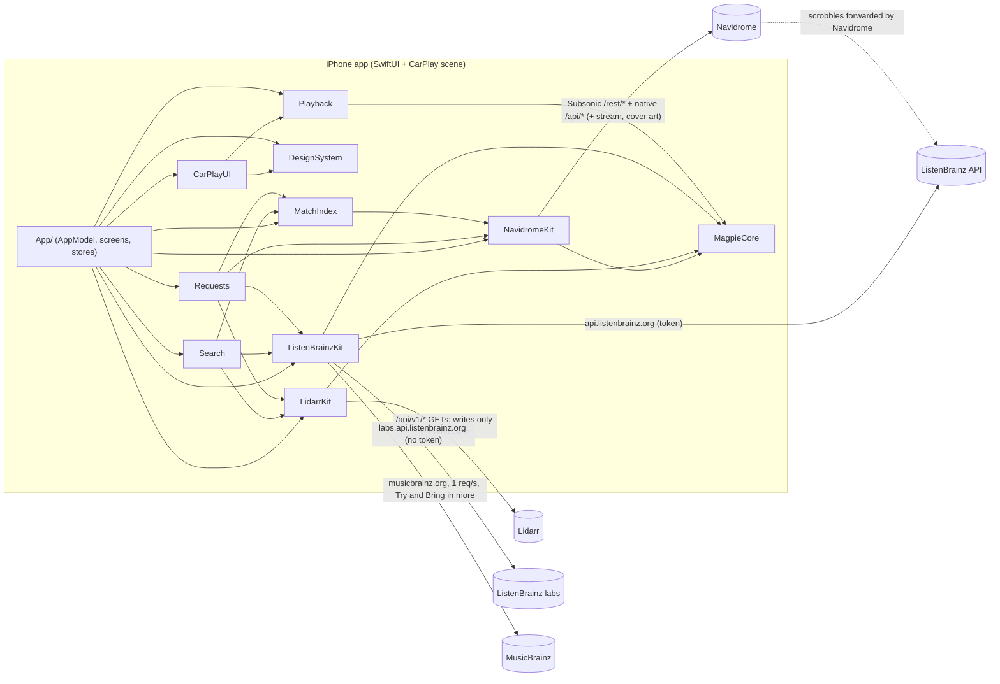

# Magpie: what it does and how

A short technical summary for the owner, written from the code on branch `v1-finds`. Service names are used freely here. In the app itself the words follow the design language (§5): "Not in your library yet", "Finds", "Keep", "Count plays".

## 1. What Magpie is

Magpie is an iPhone and CarPlay player for **your own Navidrome**. It can optionally ask **your Lidarr** to fetch a song you don't have ("Try"), and read **ListenBrainz** for search and "Made for you" playlists. There is no Magpie backend: the phone talks straight to your servers and to a few public metadata services.

| In v1 | Not in v1 |
|---|---|
| Sign-in with several addresses and automatic failover | Offline downloads, or any on-device copy of audio |
| Browse, search, play (AVQueuePlayer), queue, shuffle and repeat, lock screen and CarPlay Now Playing, lyrics (if the server has them), stars | App-side transcoding, or a quality/bitrate setting (the app never asks Navidrome for one) |
| Scrobbling through Navidrome ("Count plays"); finds are never scrobbled | Quick fetch (slskd/Soulseek). The `quickFetch` tier exists in the code but nothing ever selects it |
| Merged search: library, then ListenBrainz labs and Lidarr | Push notifications, Live Activity. The "ready" notice is a local notification, posted only while the app runs |
| Try: Lidarr adds or monitors one release and searches; the song is Ready once Navidrome lists it | Automatic expiry of finds ("days left" is display only) |
| Finds mode: a separate Finds folder, Keep (move into the library), Not for me (delete), Bring in more, Follow | Up Next and Downloaded in CarPlay; Not for me or Bring in more from the car |
| Made for you (ListenBrainz created-for playlists), "Not in your library" albums on the Artist page | Background fetch. Requests are only polled while the app process runs |

## 2. Architecture

Simplified: every module also depends on MagpieCore. MusicBrainz is asked only on a tap: Try (to resolve the song) and Bring in more (its offer and "This album only", to find the album the song is on).

MagpieCore holds the models, the HTTP transport (ephemeral, no URL cache, same-origin redirects only), the Keychain wrapper, atomic file writes and log redaction.

## 3. Flows

### a. Sign-in and session
- **Address parsing.** Text without a scheme becomes `http://` for loopback, private or home-network hosts (10/8, 172.16/12, 192.168/16, 169.254/16, 100.64/10, `.local`, single-word names, IPv6 ULA and link-local) and `https://` otherwise. An address with `user:pass@` is refused.
- **What ATS lets through.** Release builds keep only `NSAllowsLocalNetworking`. Plain `http://` works with a single-word name (`http://homeserver:4533`, verified on a real server for browsing and streaming) and, by Magpie's rules, loopback, LAN and link-local IPv4 and `.local`. A Tailscale IP (100.64/10), any other IP and dotted names (`*.ts.net`) are blocked by ATS and need HTTPS. Connect and Connect Lidarr say so before trying ("This address needs HTTPS. At home you can also use your server's short name…"), with no consent prompt and nothing sent; other addresses in the list are still tried. Debug builds have only `NSAllowsArbitraryLoads` (iOS ignores it when `NSAllowsLocalNetworking` is also present), so Debug allows plain http anywhere.
- **Local Network permission** (T3, D38; separate from ATS). iOS only lets Magpie reach home-network addresses (private and link-local IPv4, IPv6 unique-local and link-local, `.local`, single-word names) when Settings › Privacy & Security › Local Network › Magpie is on. Loopback, Tailscale (100.64/10, `*.ts.net`) and public addresses don't need it.
  - **Asked at first launch.** Once per install, whatever the first screen is, Magpie advertises its own Bonjour service (`_magpie._tcp`, taking no connections) and browses for it (both in `NSBonjourServices`; nothing is sent). Finding it means Allow. That shows iOS's prompt ("Magpie connects to your music server on your home network.") and lists Magpie under Settings › Privacy & Security › Local Network from then on. Before this, a phone whose server name resolved only through Tailscale never made a LAN connection, so Magpie never appeared there.
  - **Before signing in** to a home address, Magpie asks if it hasn't been answered. While it is known to be off, it only runs a quick check (a connection that waits with `localNetworkDenied`, within 2 s), so turning it on in Settings is noticed at once. A request that works to a home IP address or `.local` name marks it on (not a single-word name, which may go over Tailscale). The last answer is kept in the app's settings (`magpie.localNetwork.state`); `magpie.localNetwork.askedAtLaunch` records the first-launch ask.
  - **Asking again.** Connect, and Settings › Servers, show "Allow local network access" until it is known to be on. iOS shows its prompt only once; after that the button reads the setting.
  - **Diagnostics.** When no address answers, Connect explains the first failed step it can name, in address order (after certificate and https-answer trouble): `localhost` on a phone ("localhost means this iPhone itself…"), the name not found ("This iPhone can't find homeserver; check the name, or use the server's address instead."), Local Network off, no answer in time, or couldn't reach. Local Network is blamed only when it is the cause: a home address whose connection was seen held back, or a `.local` name that couldn't be looked up. A single-word name that doesn't resolve (Tailscale off, on the owner's setup) says the name wasn't found.
  - **Open Settings.** With the Local Network message ("Magpie needs local network access to reach your server. Turn it on in Settings › Privacy & Security › Local Network.", symbol `network.slash`), Connect offers "Open Settings" (Magpie's page in the Settings app); Settings › Servers shows the same message and button while it is off.
  - **CarPlay.** An out-of-reach list says "Local network access is off for Magpie" (`network.slash`) when it is off, or "Open Magpie on your iPhone once to allow local network access" (`iphone`, D33) when it was never answered and the server's address needs it.
- **Plain-http consent.** Before any password or API key goes over `http://` to a public host, the owner must agree. Consent is remembered per origin in UserDefaults (`magpie.plainHTTPConsent`).
- **Probe.** Each address is tried in order with `GET /rest/ping?v=1.16.1&c=Magpie&f=json` (no credentials, 6 s timeout; the client then pings the chosen address once more before logging in). It counts only if the answer is 2xx and a real `subsonic-response`: `ok`, or `failed` with a version and an auth error code (10, 40–44). A router page or captive portal gets no password.
- **Login.** `POST /auth/login {username, password}` returns a JWT plus a server-issued Subsonic token and salt. Subsonic calls send `u, t, s, v=1.16.1, c=Magpie, f=json`. If the server gave no token/salt, the app uses `md5(password+salt)` with a random salt. The password itself is never put in a URL. Native `/api/*` calls send the JWT in `X-ND-Authorization` and adopt a refreshed one when the server sends it.
- **Re-login.** A 401, or Subsonic error 40/44, triggers one shared re-login and one retry.
- **Resumed launch.** The saved session is used at once and reconnected in the background: the addresses are probed in order, then there is one login per launch. Calls made meanwhile (the match index, the first screens) wait for that reconnect and use its client.
- **Failover.** On a connection error (timeout, host not found, connection lost…), the app re-probes the addresses in order and retries once on the first one that answers (the client is rebuilt only if that is a different address). A playback error triggers the same check. If the address changed, the player rebuilds every stream URL and seeks back to where it was. Playback that was running carries on; playback stopped by a failed song stays paused until you press play.
- **Stored.** Addresses and credentials are kept in the Keychain (service `com.bleak-rooster.magpie.session`, `AfterFirstUnlockThisDeviceOnly`, set on every add and update). A launch before first unlock waits for unlock and does not sign out.
- **Sign-out** stops playback and clears:
  - the Keychain session and the Lidarr connection;
  - the Lidarr write switch, setup and Finds setup;
  - the account's Finds keys, the match-index snapshot and the requests file of **every** Lidarr (not only the connected one);
  - recent searches (shared by the phone and the car);
  - the ledger entries of every Lidarr whose entries are all finished (closed);
  - the in-memory artwork cache.

  It never deletes the Lidarr change log (the owner's undo map). It keeps the ledger of any Lidarr with an open entry (the owner may reconnect it; it says what Magpie may undo), the ListenBrainz token, the plain-http consent, Count plays and the look.

Code: `App/ServerAddress.swift`, `App/AppModel.swift`, `App/SessionStore.swift`, `Packages/MagpieKit/Sources/NavidromeKit/{NavidromeClient,SubsonicAuth,SubsonicPing}.swift`, `MagpieCore/{Keychain,HTTPTransport,RedirectPolicy}.swift`

### b. Browsing and the match index
- **Browsing** uses Subsonic calls: `getAlbumList2` (Home: recent, newest and frequent, 12 each; Library: alphabetical, pages of 60, and newest 24 for its Recently added row), `getAlbum`, `getArtists`, `getArtist`, `getPlaylists`/`getPlaylist`, `getTopSongs` (the Artist "Popular" list; always asked, shown only when the server's Last.fm agent returns songs), and `getCoverArt` at 120/300/600/1000 px.
- **Cover art** is cached **in memory only** (NSCache, 400 items, keyed by server, account, id and size) and cleared on sign-in and sign-out. Nothing about cover art is written to disk.
- **Match index.** After sign-in the app loads the last snapshot, then rebuilds the index in the background from `GET /api/song?_start&_end&_sort=id&_order=ASC`. It reads pages of 1,000, skips songs marked `missing`, and stops at 2,000 pages or when a server ignores paging. The index keeps only what the match ladder and the album check need:
  1. MBID
  2. ISRC
  3. artist MBID + title + duration ±3 s
  4. artist name + title + duration ±3 s
  5. artist name + title, a duration unknown

  A match must score at least 0.8. A name-only match counts in search only when it is unambiguous.
- **Stored.** The snapshot is saved to `Application Support/Magpie/MatchIndex/<first 32 hex of sha256(first address|user)>.json` with an atomic write (`completeFileProtectionUntilFirstUserAuthentication`) and is excluded from backup. A failed refresh keeps the previous index.

Code: `MatchIndex/{MatchIndexStore,MatchIndex,Normalize}.swift`, `App/Screens/Shared/Artwork.swift`, `App/Screens/Home/HomeView.swift`, `App/Screens/Library/*`

### c. Playback and streaming
- **Stream URL.** `GET /rest/stream?id=<song>&estimateContentLength=true` plus the Subsonic auth parameters. The app sends **no `format` and no `maxBitRate`**: the stream-URL builder supports them, but they are always nil. **Magpie never transcodes.** Whatever transcoding happens is Navidrome's own server-side choice. With no format requested, Navidrome sends the original file unless a transcoding is configured for the Magpie player on the server.
- **What gets stored on the server** is decided by the Magpie quality profiles in Lidarr:
  - *Fast Start* (MP3-320 / MP3 V0, no upgrade) for Try;
  - *Lossless* (FLAC, upgrades allowed) after Keep.
- **Engine.** One `Player` owns the queue and drives an `AVQueuePlayer`. The AVQueuePlayer holds the current song plus at most one more. The next song is appended when 20 s or less are left, or straight away while the length is unknown (which includes the moment a song is loaded, so the next one is usually queued at once). Repeat one queues nothing after the current song. That makes playback gapless when the files carry gapless info.
- **Audio session.** `.playback` / `.longFormAudio`, activated on the first play (so CarPlay doesn't cut the car's radio early).
- **Pauses and recovery.** Playback pauses when headphones or the car disconnect. It resumes after an interruption when the system recommends it, and the player is rebuilt if media services reset.
- **Failures.** A failed current song stops playback rather than skipping through the queue. It stays paused, with the error, until you press play, even if the failover check finds another address; play then retries the song on the new address from where it stopped. Repeat (off/all/one) and shuffle are kept in memory only.
- **Background audio** works through `UIBackgroundModes: audio`.
- **Now Playing** (lock screen, Control Center, CarPlay) gets the title, artist, album, times, queue index and artwork. The artwork is a 600 px cover fetched with an ephemeral session that has no cache.
- **Remote commands:** play, pause, toggle, next, previous, seek, shuffle, repeat and like (which toggles the star: it stars the song, or unstars one that is already starred). The like button's state follows the app's star state at once, including a like made a moment ago.
- **Lyrics** use `getLyricsBySongId`. The button shows only when `getOpenSubsonicExtensions` lists `songLyrics`.
- **No audio is ever cached or stored on the device.** Streams use AVPlayer's normal network loading, and the app has no download code.

Code: `Playback/{Player,AVQueueEngine,PlaybackEngine,Queue,NowPlayingBridge}.swift`, `App/Playback/NavidromeAdapters.swift`, `NavidromeClient.streamURL`, `LidarrKit/Provisioner.swift` (profiles), `project.yml` (background mode)

### d. Scrobbling ("Count plays")
- **When.** Whenever a song is loaded to play (including a retry after an error, a repeat-one replay or playing again after the queue ended), the app sends `scrobble?submission=false` ("now playing"). At 50 % of the song or 240 s, whichever comes first, it sends `submission=true` with the start time.
- **Who forwards it.** Navidrome passes the play on to ListenBrainz or Last.fm if *you* have linked them in Navidrome. The app itself never posts listens to ListenBrainz.
- **The switch.** Count plays is on by default and stored in UserDefaults (`magpie.countPlays`). It is read on every scrobble.
- **D29: finds are never scrobbled.** Neither "now playing" nor the submission is sent for a find. A song counts as a find as follows. If it carries a library id and a Finds library is set, that id alone decides. Otherwise it is a find when any of these is true (unless it was confirmed in the main library after Keep):
  - its library id is the Finds library;
  - it is among the Finds library's songs as last read (saved in UserDefaults);
  - it belongs to a ready Finds-mode request (marked the moment the request is ready, before it lands).
- **Fail-closed.** While a Finds library is set but its songs aren't known yet, every song without a library id counts as a find. A song confirmed in the main library after Keep stops being a find.

Code: `Playback/Player.swift` (`scrobble`, `maybeSubmitScrobble`), `App/Playback/NavidromeAdapters.swift` (`FindsIdentity`, `NavidromeScrobbler`), `App/AppModel+Finds.swift`

### e. Search
- **Sources run in parallel.** Library `search3` has a 3 s deadline on the phone. ListenBrainz labs `recording-search` (songs only, no token) and, when Lidarr is connected, Lidarr `GET /search` (artists and albums only) each have 5 s. In the car the outside sources get 1.5 s.
- **Library rows come first** and show as soon as the library answers.
- **The "Not in your library" band** shows outside songs, albums and artists. An outside hit is dropped when the match index, or the library rows on screen, already have it. It is limited to 10 songs, 8 albums and 5 artists, with one song row per artist and title (albums and artists once each).
- **Failures.** A source that fails or runs out of time adds nothing. A search fails only when the library fails *and* nothing came from outside.
- **What can be tried.** Only songs have Try. Album and artist rows are information only.

Code: `Search/{MergedSearch,SearchSections}.swift`, `ListenBrainzKit/ListenBrainzClient.swift`, `App/AppModel.swift` (`mergedSearch`), `App/Screens/Search/*`

### f. Requesting a song ("Try")
"Quick" here means Lidarr's normal search-and-download pipeline. **Quick fetch via slskd is not built in v1.**

- **Preconditions** (`tryAvailability`): Lidarr connected, "Allow Magpie to change Lidarr" on, "Set up Magpie in Lidarr" done, and a main root folder chosen.
- **Speed tier.** Standard ("usually a few minutes", live wait screen) when Lidarr's `/system/plugins` mentions Tubifarry. Otherwise Patient ("can take a few hours", no wait screen): the not-yet row's button and the sheet both say "Ask for it". These are estimates shown to you, not guarantees.
- **Limits.** At most 5 places are in use at once: requests plus releases from Bring in more. A second Try of the same song returns the existing request.
- **Resolve.**
  - `GET musicbrainz.org/ws/2/recording/<mbid>?inc=releases+release-groups+isrcs+artist-credits`, at most 1 request per second, and only on a tap: Try, and Bring in more's offer (to find the album the song is on). A song with no recording MBID fails ("no release").
  - Release choice: one release group containing the song, ranked rather than measured: groups with no secondary type come first, then Official, then Single < EP < Album, then the earliest date.
  - *Known behaviour:* only the releases MusicBrainz lists for *this recording* count. When the single is a separate recording in MusicBrainz (or isn't an Official studio single), the album is the smallest choice, so Try monitors and downloads the whole album (seen on a real server: two Tries brought in 11-track albums). Matching a single by title across recordings is not in v1.
  - For a **new artist**, only Official Album/EP/Single studio releases qualify. For an **artist already in Lidarr**, only the release groups Lidarr already lists qualify (except an artist Magpie itself added whose albums Lidarr hasn't listed yet: that one is picked for like a new artist, and the request waits for the album). The artist's profiles are never changed.
- **Lidarr writes** (all through the WriteGate):
  - *Artist already in Lidarr:* `PUT /album/monitor {albumIds:[id], monitored:true}` (only if it isn't monitored yet), then `POST /command {name:"AlbumSearch", albumIds:[id]}`. Nothing about the artist is changed.
  - *New artist:* one `POST /artist` built from `artist/lookup?term=lidarr:<mbid>`. It sets the root folder, the *Fast Start* quality profile, the *Magpie Finds* metadata profile, `monitored:true`, `monitorNewItems:"none"`, tags, `addOptions {albumsToMonitor:[rg], searchForMissingAlbums:true}`. `addOptions.monitor` is deliberately left out.
  - *Fallback mode* (Finds off or not complete): main root, tag `magpie`.
  - *Finds mode:* the Finds root with tags `magpie` + `magpie-find`, but only if the Finds root still checks out against freshly read root folders. Otherwise the song goes into the main root, and the request's wait and detail screen says so.
  - *Which mode:* only a new artist becomes a find. A song by an artist already in Lidarr goes to the library in Finds mode too, unless that artist is a find right now (Magpie added it, it is tagged `magpie-find`, and its folder is inside a Finds root that still checks out). Then the song is a find as well. Nothing about the artist is written either way.
  - *"Magpie added it"* means a ledger entry says so for the same Lidarr artist id **and** the same artist MBID: Lidarr can give a deleted artist's id to another artist, and that one is never treated as Magpie's.
- **Persist before write.** The request list (`addSent`, ids) is saved before every write. The ledger entry is saved as "unclear" before a monitor PUT and updated after it. If the save fails, nothing is sent.
- **Progress.** The runner polls every 5 s in the foreground and every 30 s otherwise, while the process runs. It reads:
  - `queue/details` for progress and stuck imports;
  - `history/since` for grabbed, imported and failed events;
  - `command/<id>` to tell whether the search has finished.

  Ten minutes after the search started, with nothing queued or grabbed and Lidarr's search command finished, the request waits as "still looking". Retries resend `AlbumSearch` after 1, 5 and 15 min, then hourly (each retry first checks the album is still monitored), and the request gives up after 24 h of waiting without progress.
- **Waiting copy.** A request that can't reach what it needs (Lidarr, or the MusicBrainz lookup, which answers "busy" now and then) waits and retries on its own. The first such wait reads "Still looking…"; only a repeat says "Can't bring songs home right now. We'll try again." The request screen is titled with the song.
- **Ready** means *Navidrome lists the song*, not that Lidarr imported it:
  - After an import, the app starts a quick scan of the whole library (`startScan?fullScan=false`, no target). Scans repeat every 2–10 min.
  - The match index is refreshed every 30 s–5 min, at least 2 min apart while a scan runs.
  - Whenever the index matches the recording, the request becomes Ready.
  - Still not listed 20 min after the import: "Not showing up in your library yet" with **Check again**.

  Targeted scans are used only by Keep.
- **Landing (D6).** If you are still on the song's wait screen with the app in the foreground and nothing is playing, it plays. Otherwise it goes next in the queue (never cutting in) and a **Play now** banner appears (its pause and close buttons are 44 pt; the title truncates, and the record icon goes when there is no room). Patient requests don't land: they just appear in the library or Finds. A local "is ready" notification is posted if allowed.
- **Cancel** never deletes. It unmonitors the album only if the ledger says Magpie monitored it, it isn't kept, no other live request needs it, and a fresh GET shows it is still monitored. For a newly added artist it keeps checking for 10 min. An artist Magpie added stays in Lidarr.

Code: `Requests/{RequestRunner,RequestMachine,ReleasePicker,RequestStore}.swift`, `ListenBrainzKit/MusicBrainzClient.swift`, `App/AppModel+Requests.swift`, `App/AppModel+Landing.swift`, `Playback/LandingRule.swift`, `App/ReadyNotifier.swift`, `App/Screens/Try/TrySheet.swift`

### g. Finds
- **Setup** writes nothing to Lidarr. You start by turning on "Use a Finds folder"; the folder, library and mapping choices appear once it is on, and Finds mode only starts when all of them are done. You pick a Finds root from Lidarr's root folders and confirm it ("Use … for Finds?"). It is refused if it equals, holds or sits inside another root or the main root. You then pick the Navidrome library that is the same folder (`/api/library`, which needs an admin login on some versions) and, if Lidarr and Navidrome see different mount paths, a Lidarr→Navidrome path mapping. The setup is stored in UserDefaults per Lidarr instance and Navidrome account (`magpie.finds.<lidarr>.<navidrome>`).
- **Shelf.** The Finds library's songs come from `/api/song?library_id=` (pages of 500, at most 200 pages; a read that stops at the limit is logged, and until a complete read every unknown song counts as a find, so it is never scrobbled). New finds are finds not played yet. "Days left" is 7 minus whole days since the song was added. Nothing leaves on its own.
- **Keep** is only for an artist the ledger says Magpie created (same artist id and MBID), tagged `magpie-find`, strictly inside the Finds root (fresh reads), with no move or other command queued in Lidarr.
  - **Normal case:** one `PUT /artist/editor {artistIds:[id], rootFolderPath:<main root>, moveFiles:true, qualityProfileId:<Magpie Lossless>, tags:[magpie-find], applyTags:"remove"}`.
  - **Proving the move:** Magpie then waits for Lidarr's `BulkMoveArtist`. It confirms every track file is on disk in the new folder using Lidarr's **filesystem listing** (`GET /filesystem`), because Lidarr 3.2 leaves `trackfile` paths stale after a move. It also checks the old folder is gone.
  - **After the move:** one quick scan targeting the whole Finds library (`<findsLibraryId>:`) and the artist's new folder (`<libraryId>:<path>`, through the mapping); if the new folder can't be placed in exactly one other library, a plain quick scan instead. The song is then looked up again by recording MBID in its new folder. It shows "Lossless soon" until the FLAC arrives.
  - **Name clash:** if the main root already has a folder of either name (ignoring case, accents and width), or Lidarr's folder name is unknown or differs at all from the current one, only the tag comes off ("stays in your Finds folder").
  - **Failed move:** a failure is put back. Anything it can't settle within 30 min or 5 restore writes ends in **Needs attention**, and nothing more is written.
- **Not for me** deletes the whole release, and only for a ready Finds-mode find of an artist Magpie added.
  - **Checks first:** a confirm sheet reads Lidarr's recycle bin and says "deletes permanently" if none is set. Before every delete it re-proves on fresh reads: ledger (same artist id and MBID), nothing of the artist kept, Finds root valid, `magpie-find`, every file of the artist strictly inside the Finds root and the artist folder, and every file to delete on disk where Lidarr records it. The unmonitor step relies on the gate's ledger check. The artist delete re-proves the ledger and the find and checks the folder is empty.
  - **Writes:**
    - `DELETE /trackfile/bulk {trackFileIds}` (or one `DELETE /trackfile/{id}` at a time if the bulk route is missing);
    - `PUT /album/monitor {monitored:false}`;
    - `DELETE /artist/{id}?deleteFiles=false&addImportListExclusion=false`, only when the artist's folder holds no file at all on disk.

    The whole Not for me is bounded (30 min from its start, a write budget, at most 3 unanswered writes). Once a write may have reached Lidarr, failures end in Needs attention. A refusal before anything was sent just cancels it, and a refused artist delete leaves the artist.
- **Bring in more** (only after a Keep that moved the find): `PUT /album/monitor {monitored:true}` for the releases of the choice you pick (Albums and EPs, This album only or Everything) that aren't monitored yet and that the sheet offered (newest first, at most 20, within the room left in the limit of 5; each counts as a place until it has files), then one `AlbumSearch`.
- **Follow new releases:** `PUT /artist/editor {artistIds:[id], monitorNewItems:"new"}`, skipped if the artist already follows.

Code: `App/{FindsSetupStore,AppModel+Finds,AppModel+Keep,AppModel+NotForMe,AppModel+BringInMore}.swift`, `Requests/RequestRunner+{Keep,NotForMe,BringInMore}.swift`, `LidarrKit/{PathGuard,LidarrClient}.swift`, `App/Screens/Finds/FindsShelf.swift`

### h. Made for you and "Not in your library"
- **Made for you** appears only with a ListenBrainz token. The token is checked with `GET api.listenbrainz.org/1/validate-token` before it is saved to the Keychain.
- **Reading the shelf:** `1/user/<name>/playlists/createdfor`, then `1/playlist/<mbid>`. Calls are spaced to 2 per second with a 5 s limit, and the shelf shows the newest playlist of each kind, at most 6.
- **Playlist songs** are split by the match ladder into playable library songs and songs you can Try. Failures are quiet: with nothing read yet the section is left out, and a failed refresh keeps what is shown.
- **The token goes only to `api.listenbrainz.org`**, never to labs.
- **Artist page "Not in your library":**
  - With the artist's MBID, Lidarr's `artist/lookup`, then that artist's `album` list if Lidarr has the artist. Otherwise Lidarr's text search, keeping album rows by that artist.
  - Albums the library already has are dropped. It shows at most 30, has a 5 s limit and is read-only.

Code: `Search/{MadeForYou,ArtistNotYet}.swift`, `App/AppModel+MadeForYou.swift`, `App/LidarrConnectionStore.swift` (`ListenBrainzTokenStore`)

### i. CarPlay
- **Tabs.** Home, Library, Finds and Search. The Finds tab exists only when the head unit allows 4 tabs, and it shows "not set up" without a Finds library.
- **Keep.** Now Playing shows the system add-to-library (+) button as **Keep** for a find that may be kept. It is the same Keep as on the phone, one tap with no confirmation, and has no Bring in more.
- **Search** in the car gives library songs and albums, then outside songs only (1.5 s source deadline; the library keeps a 60 s limit in the car).
- **Try it next.** A not-yet song offers **Try it next** / Cancel, using the phone's Try. With an empty queue, a **bridge mix** starts at once: library songs by that artist (from `search3`), topped up from 4 random albums when the artist has fewer than 10, with finds excluded. The find then goes next when ready. If no mix can be made, the find plays itself when it lands, as long as nothing else has started by then (a request cancelled or failed meanwhile never starts). Patient tier is "asked for" only.
- **Not for me** is not offered in the car.
- **Builds.** Device builds without the CarPlay entitlement drop the CarPlay scene.

Code: `Packages/MagpieKit/Sources/CarPlayUI/*`, `App/CarPlay/CarPlaySceneDelegate.swift`, `App/AppModel+CarPlay.swift`, `project.yml`

### j. Safety layers
- **Allow-changes switch.** Off by default and stored per Lidarr instance in UserDefaults (`magpie.lidarr.writesEnabled.<scope>`, where scope is a hash of the address and API key). It is reset on connect, disconnect and sign-out, so a new Lidarr always starts off.
- **WriteGate (G1).** `LidarrClient` can only send GETs. Only `WriteGate.swift` can send a Lidarr POST, PUT or DELETE, and `scripts/check-writes.sh` enforces that (the Navidrome login POST is the one allowlisted exception).
  - **Never-call list:** `config/*`, root folders, indexers, download clients, notifications, import lists, `system`, changing or deleting profiles, `missing` cleanup, `DELETE artist/editor`, and any `deleteFiles` or `addImportListExclusion` that isn't false.
  - **Allow list:**
    - `POST` `tag`, `qualityprofile`, `metadataprofile`, `artist`, and `command` (AlbumSearch, ArtistSearch, RefreshArtist or RefreshAlbum only);
    - `PUT` `artist/editor` (limited keys, one artist) and `album/monitor`;
    - `DELETE` `artist/{id}` (with both flags false) and `trackfile/{id|bulk}`.
  - **Body check:** request bodies are scanned for non-ASCII or duplicate keys.
- **Confinement (FM1).** Deletes and artist edits are re-checked *at the gate* against the ledger (same artist id and MBID) and fresh Lidarr reads, and album monitors against the ledger, one at a time. Anything unreadable is refused.
- **Change log.** Every write (method, path and body with secrets masked, then the HTTP status) is saved *before* it is sent to `Application Support/Magpie/lidarr-change-log.json` (at most 5,000 entries). If it can't be saved, nothing is sent. You can see it in Settings.
- **Ledger.** `Application Support/Magpie/lidarr-ledger.json` records every album and artist Magpie touched (with the artist's MBID), scoped per Lidarr instance. Deletes and unmonitors need its say-so.
- **Requests file.** `Application Support/Magpie/requests-<scope>.json`. A file that can't be read right now is left alone and nothing is saved over it; a damaged file is moved aside.
- **G7 limits.** 5 places, 20 releases per Bring in more, 1 MusicBrainz request per second, scans at most once per 10 s per target and always quick (`fullScan=false`).
- **Redaction.** Logs mask `u, t, s, p, apikey, token, password` and the auth headers. Most errors are logged by category only (a failed scrobble's message is logged as private).
- **Networking.** The HTTP sessions are ephemeral with no URL cache, and redirects are followed only within the same origin.
- **ATS.** Release: `NSAllowsLocalNetworking` only (see §3a for what it lets through). Debug: `NSAllowsArbitraryLoads` only (the local-networking key is removed, or iOS would ignore arbitrary loads). `scripts/check-release.sh` checks that Release never has arbitrary loads.

Code: `LidarrKit/{WriteGate,WriteConfinement,Ledger,LocalFile}.swift`, `MagpieCore/{Redactor,Log,AtomicFile}.swift`, `scripts/check-writes.sh`

## 4. Where data lives and what leaves the phone

| Data | Where | Protection |
|---|---|---|
| Navidrome addresses + credentials, Lidarr address + API key, ListenBrainz token | Keychain, service `com.bleak-rooster.magpie.session` | `AfterFirstUnlockThisDeviceOnly` |
| Write switch, Lidarr setup, Finds setup, Finds library id, Finds song ids and played finds, Count plays, http consent, look, recent searches (last 8 queries, cleared on sign-out) | UserDefaults | none (not secret) |
| Match index snapshot, change log, ledger, requests | `Application Support/Magpie/…` | atomic writes, `completeFileProtectionUntilFirstUserAuthentication`, excluded from backup. On sign-out: snapshot and every requests file erased; ledger entries kept only for a Lidarr with an open entry; change log never deleted |
| Cover art | memory only | cleared on sign-in/out |
| Audio | nowhere: streamed | n/a |

| Host | What is sent |
|---|---|
| Your Navidrome | login (the password, only ever in a POST body, on every login: sign-in, once per launch, a switch of address, a re-login after 401), token+salt on every Subsonic URL (including stream and cover URLs), JWT header, scrobbles, stars, scans |
| Your Lidarr | API key header on every call; GETs, and writes only through the gate |
| labs.api.listenbrainz.org | search text only |
| api.listenbrainz.org | token, your ListenBrainz user name in the path (Made for you, token check) |
| musicbrainz.org | recording MBID with a User-Agent (Try, and Bring in more: its offer and "This album only") |
| Lidarr's metadata server (indirectly) | search terms and MBIDs, via Lidarr's `search` and `lookup` |

## 5. Known limits
- Requests advance only while the app is running. There is no background fetch, and the ready notice is local only.
- Ready depends on Navidrome scanning the folder Lidarr writes into. If the two see the folder at different paths, a song can stay "Bringing it home". Fallback mode has no path mapping; only Finds setup has one.
- Lidarr 3.2 keeps stale track-file paths after a move. Keep and Not for me therefore never trust the records alone: each file must also be found where expected in Lidarr's filesystem listing.
- The ListenBrainz token survives sign-out (security L1).
- Plain http in TestFlight (Release) builds works only to home-network addresses; a Tailscale IP or `*.ts.net` name needs HTTPS (§3a).
- Try can bring in a whole album for one song when MusicBrainz lists the single as a separate recording (§3f, Release choice).
- Sign-out erases every requests file, so finds from before a sign-out can't be kept or let go of from Magpie any more (Keep and Not for me need their request). Their ledger entries are still kept: a Lidarr's open entries can't be closed afterwards and stay on the phone, keeping that Lidarr's Magpie-added artists recognised as Magpie's after a reconnect.
- AVPlayer follows stream redirects itself, so the same-origin rule doesn't cover streams. Stream URLs carry a replayable token, so use HTTPS away from home.
- CarPlay hasn't been visually verified. Physical-device CarPlay needs Apple's entitlement.
- More: [RUNBOOK §5](RUNBOOK.md#5-known-limits-risks-and-troubleshooting) and the residual risks in [security-v1-finds.md](reviews/security-v1-finds.md#residual-risks-accepted-or-out-of-client-reach).
